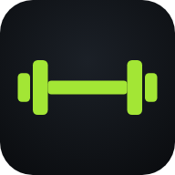
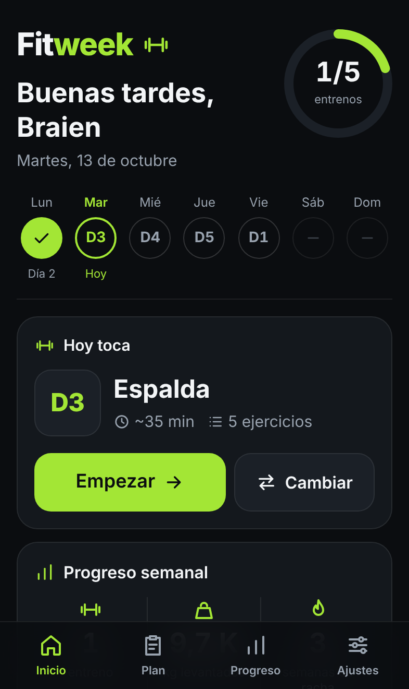
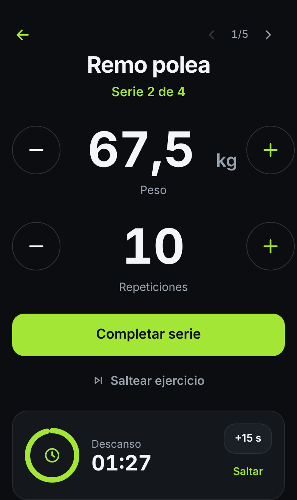
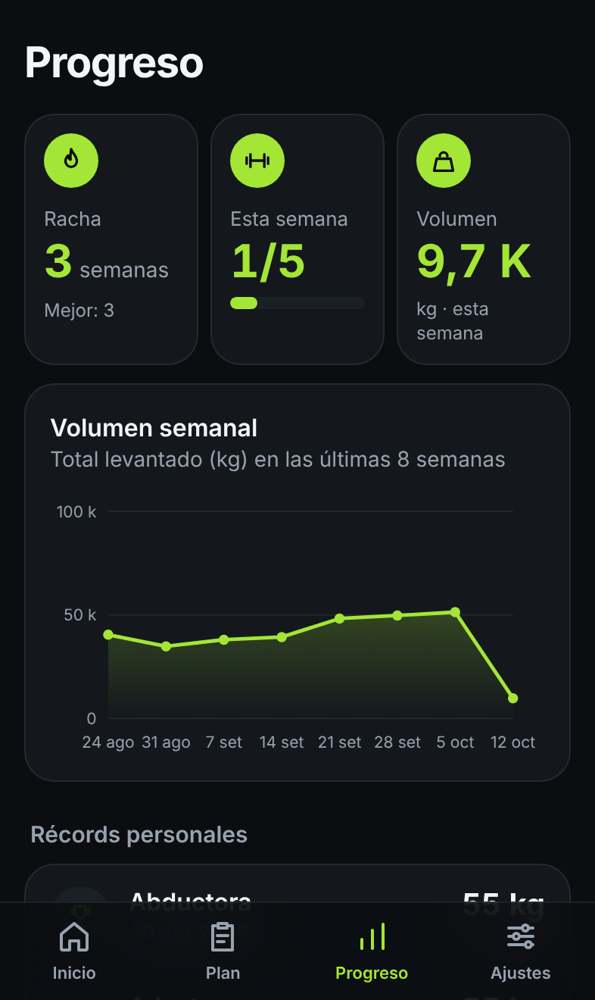
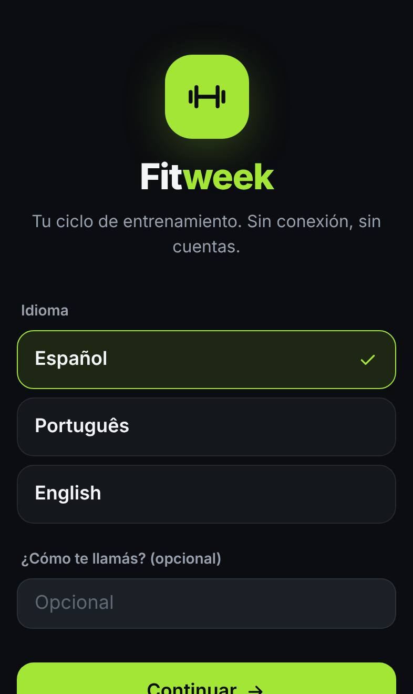
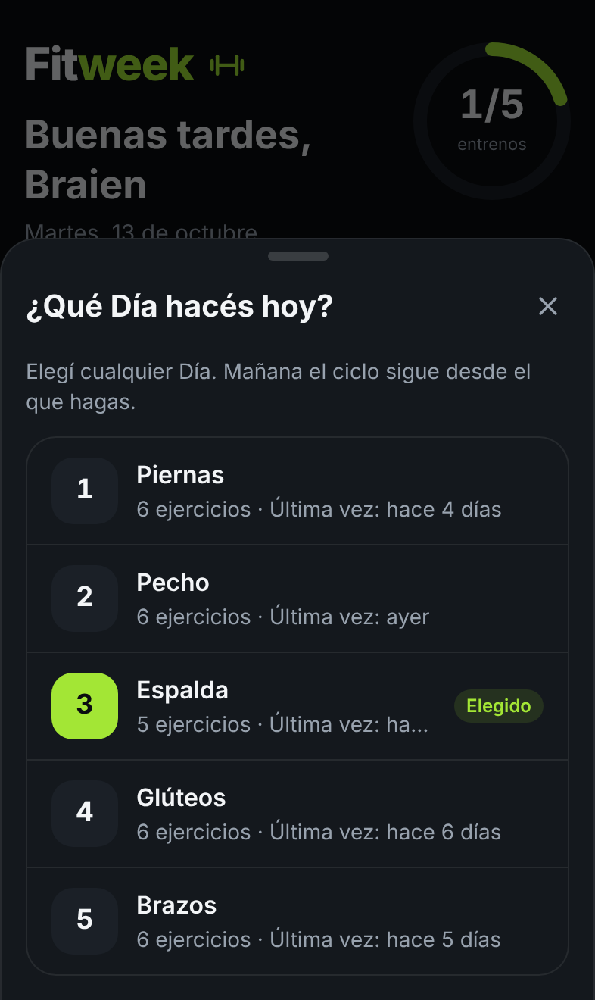
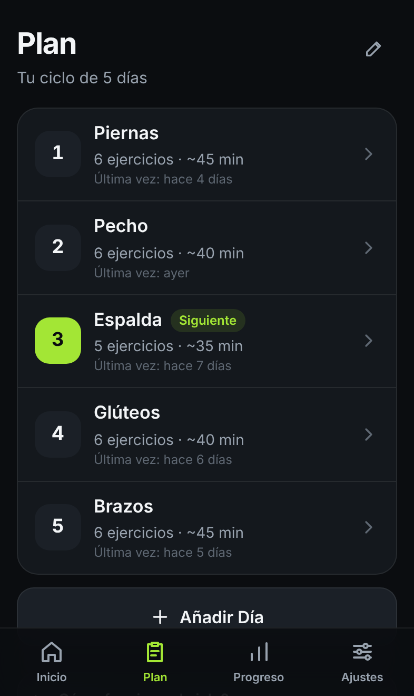
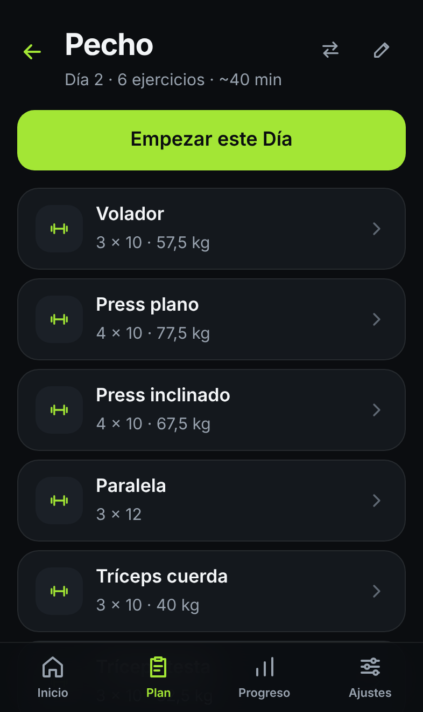
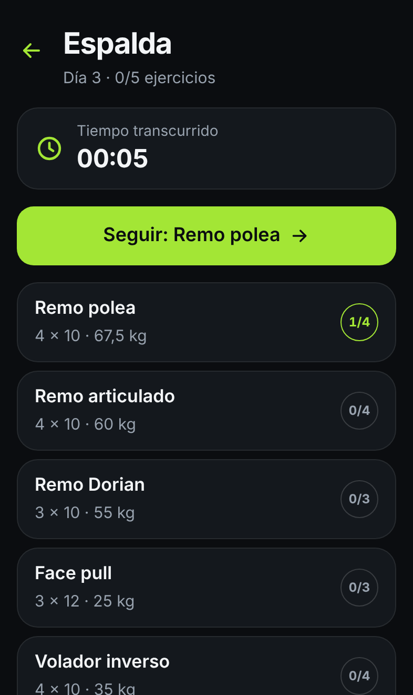
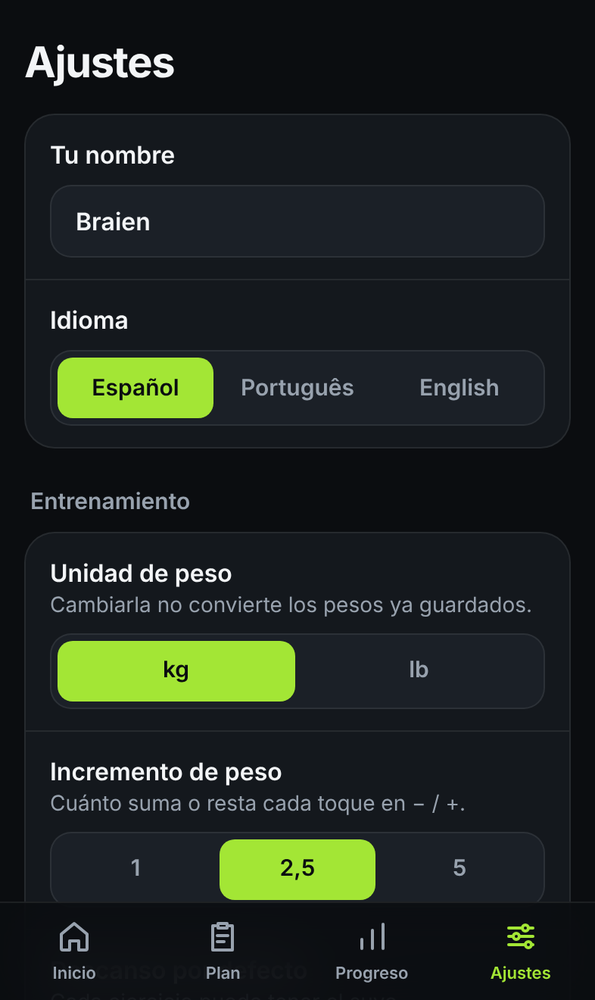

  

<h1 align="center">FitWeek</h1>

  <b>Tu ciclo de entrenamiento, en el bolsillo.</b> 
  Una app para el gimnasio que se adapta a tu semana real: si faltás un día, el plan te espera.

  <a href="https://bradithanapps.github.io/fitweek/"><b>Abrir FitWeek →</b></a>
  &nbsp;·&nbsp; Funciona sin conexión &nbsp;·&nbsp; Sin cuentas &nbsp;·&nbsp; Español · Português · English

  
  &nbsp;
  
  &nbsp;
  

---

## ¿Qué es FitWeek?

La mayoría de las apps de rutinas asignan un entreno a cada día de la semana: «lunes piernas, martes pecho». Pero si un martes no podés ir, el plan se desarma.

FitWeek funciona con un **ciclo de Días**. Armás tu rutina una vez (Día 1 Piernas, Día 2 Pecho, Día 3 Espalda…) y la app te va sugiriendo el que sigue según lo que **realmente** hiciste.

- **Faltaste un día:** no pasa nada. Cuenta como descanso y mañana te toca el mismo Día.
- **No tenés ganas de hacer lo que toca:** tocás **Cambiar** y elegís otro. El ciclo sigue desde ese.
- **Terminaste el último Día:** vuelve al primero.

### Un ejemplo

| | Lun | Mar | Mié | Jue | Vie |
|---|:---:|:---:|:---:|:---:|:---:|
| La app sugiere | Día 1 | Día 2 | Día 2 | Día 3 | Día 1 |
| Lo que hiciste | ✅ Día 1 | descanso | ✅ Día 2 | ✅ Día 5 *(elegido)* | ✅ Día 3 *(cambiado)* |

---

## Funciones

**Tu plan, a tu manera**
- Días con el nombre que quieras y ejercicios cargados a mano: *Press plano 4×10*, *Paralela 3×12*, *Volador 3×10*.
- Repeticiones fijas o **al fallo**, descanso propio por ejercicio y un orden que se cambia cuando quieras.
- Incluye un **ejemplo de 5 Días** listo para usar y editar.

**Durante el entreno**
- Pantalla grande y simple, pensada para usar con una mano entre series.
- Peso y repeticiones con botones − / + grandes, o tocando el número para escribirlo.
- **El peso se guarda solo:** si subís el peso, la próxima vez arranca desde ahí. Si bajás en la última serie por cansancio, no se pisa tu marca.
- **Temporizador de descanso** con aviso sonoro, +15 s y saltar.
- Si cerrás la app en medio del entreno, al volver sigue donde estabas.

**Tu progreso**
- **Racha** de semanas cumpliendo tu objetivo, sin que un día de descanso la corte.
- **Volumen semanal** de las últimas 8 semanas.
- **Récords personales** y la evolución de cada ejercicio.
- **Historial** con el detalle de cada sesión.

**Tus datos, solo tuyos**
- Todo se guarda en tu teléfono: sin cuentas, sin servidores, sin rastreo.
- Funciona **100 % sin conexión**, incluso en modo avión.
- **Respaldo** para exportar e importar tus datos cuando quieras.

---

## Capturas

<table>
  <tr>
    <td align="center"> Bienvenida e idioma</td>
    <td align="center"> Elegir otro Día para hoy</td>
    <td align="center"> Tu ciclo de Días</td>
  </tr>
  <tr>
    <td align="center"> Ejercicios de un Día</td>
    <td align="center"> Sesión en curso</td>
    <td align="center"> Ajustes y respaldo</td>
  </tr>
</table>

---

## Instalarla

Abrí **[bradithanapps.github.io/fitweek](https://bradithanapps.github.io/fitweek/)** en el celular. En Inicio aparece el aviso **Instalá FitWeek**:

- **Android (Chrome, Edge, Samsung Internet):** tocá **Instalar** y confirmá. Queda como cualquier otra app.
- **iPhone (Safari):** Apple no permite instalar con un botón, así que la app te muestra los pasos: **Compartir** → **Añadir a pantalla de inicio** → **Añadir**.

Abrila una vez con conexión desde el ícono. A partir de ahí funciona sin internet.

> Tus datos viven en tu teléfono. Si borrás la app, se pierden: usá **Ajustes → Exportar respaldo** de vez en cuando.

---

## Para desarrolladores

FitWeek es una PWA hecha con HTML, JavaScript moderno (ES Modules), Tailwind CSS 4, IndexedDB, un Service Worker propio y Vite, sin frameworks ni dependencias en tiempo de ejecución.

Cómo ejecutarla, compilarla, publicarla e instalarla desde Windows: **[docs/DESARROLLO.md](docs/DESARROLLO.md)**.

---

Hecho por <b>Bradithan</b>

